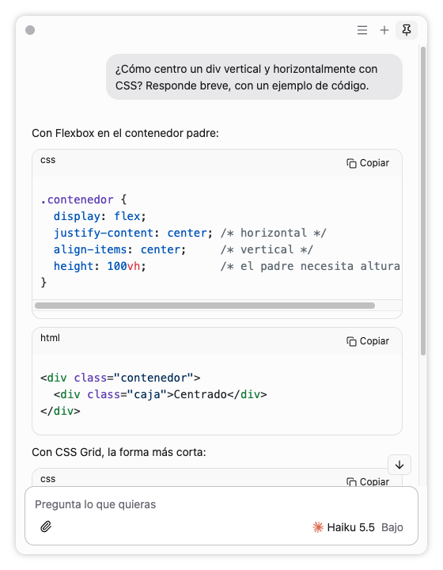

<p align="center">
  
</p>

<h1 align="center">J7 Chat</h1>

<p align="center">
  Una barra de consultas rápidas para macOS. Aprietas un atajo desde cualquier app, preguntas y sigues trabajando.<br>
  Puedes adjuntar una captura de la pantalla o archivos, y dictar con la voz.
</p>

<p align="center">
  <a href="../../releases/latest"></a>
  
  <a href="../../actions/workflows/ci.yml"></a>
  <a href="LICENSE"></a>
</p>

<p align="center">
  <picture>
    <source media="(prefers-color-scheme: dark)" srcset="docs/images/j7-oscuro.png">
    
  </picture>
</p>

J7 no tiene modelos ni cuentas propias. Usa los programas de IA que ya tienes instalados y con sesión iniciada en tu Mac (Claude Code o Codex), así que responde con tu suscripción y no pide claves de API.

> Requiere un Mac con Apple Silicon (M1 o posterior) y macOS 14 o más nuevo.

## Funciona mejor con

| Programa | Para qué | Descarga |
| --- | --- | --- |
| [Claude Code](https://code.claude.com/docs/en/setup) | Modelos de Claude (Opus, Sonnet, Haiku…) con tu cuenta de Claude | `curl -fsSL https://claude.ai/install.sh \| bash` |
| [Codex](https://developers.openai.com/codex/cli) | Modelos de OpenAI con tu cuenta de ChatGPT | `curl -fsSL https://chatgpt.com/codex/install.sh \| sh` |
| [Hex](https://github.com/anomalyco/hex) | Dictado por voz, local y privado (opcional) | [Descargar DMG](https://anoma.ly/hex/download/macos-arm64-dmg) · requiere macOS 15 |

Necesitas al menos uno: Claude Code o Codex. Hex es opcional: sin Hex, J7 funciona igual, pero sin voz. J7 también aprovecha [OpenCode](https://opencode.ai) si ya lo tienes.

## Instalar paso a paso

**1. Instala J7**

1. Descarga el DMG de la última versión en [Releases](../../releases/latest).
2. Ábrelo y arrastra **J7 Chat** a Aplicaciones.
3. La primera vez, macOS la bloquea porque no está notarizada por Apple. Ábrela una vez y luego ve a **Ajustes del Sistema → Privacidad y seguridad → Abrir igualmente**. También puedes quitarle la marca de descarga desde la Terminal:
   ```sh
   xattr -dr com.apple.quarantine "/Applications/J7 Chat.app"
   ```

J7 vive en la barra de menús, no en el Dock.

**2. Conecta tu cuenta de Claude o de ChatGPT**

Si a J7 le falta algo, al abrirla se abre sola en **Ajustes → Programas**. Ahí cada programa tiene su botón **Descargar** y los comandos para copiar.

1. Abre la app **Terminal**, pega el comando de instalación de la tabla de arriba y presiona Enter.
2. Inicia sesión con `claude auth login` (Claude Code) o `codex login` (Codex). Se abre el navegador para que entres con tu cuenta.
3. Vuelve a J7: detecta el programa solo y usa esa misma cuenta. No pide claves ni contraseñas.

**3. Da los permisos**

En **Ajustes → Permisos**, cada permiso tiene un botón que abre la página exacta de Ajustes del Sistema:

| A quién | Permiso | Para qué |
| --- | --- | --- |
| J7 Chat | Grabación de pantalla | Las capturas |
| J7 Chat | Monitoreo de entrada | La tecla de voz |
| Hex | Micrófono | Escucharte |
| Hex | Accesibilidad | Dictar |

Los de Hex se le dan a **Hex**, no a J7: en la lista de Ajustes del Sistema, activa Hex. Claude Code y Codex no necesitan permisos. Si macOS lo pide, usa **Reiniciar J7**.

**4. Voz (opcional)**

Descarga [Hex](https://anoma.ly/hex/download/macos-arm64-dmg), ábrelo una vez y sigue sus pasos (descarga el modelo de voz). Después, mantén `⌥` derecho en cualquier app para dictarle a J7.

## Cómo se usa

| Atajo | Qué hace |
| --- | --- |
| `⌥ Espacio` | Abre o cierra la barra |
| `⌥ ⇧ J` | Captura una zona de la pantalla y la adjunta a tu pregunta |
| Mantener `⌥` derecha | Captura la pantalla y dicta con Hex mientras la mantienes; al soltar, envía |
| Doble toque en `⌥` derecha | Igual, pero sigue grabando sin mantener la tecla; `Enter` u otro toque envía |
| `⌘ ,` | Ajustes |

Los atajos se cambian en **Ajustes → Atajos**. Si Hex usa la misma tecla que J7, el ajuste te avisa.

Para adjuntar archivos, arrástralos a la barra o usa el clip. J7 lee imágenes, PDF y texto.

Tus chats, ajustes y adjuntos se guardan solo en tu Mac, en `~/Library/Application Support/J7 Chat`. Para actualizar, cierra J7 y reemplaza la app por la nueva; tus datos se conservan.

## Compilarla tú

Necesitas Node 24 o más nuevo y las herramientas de línea de comandos de Xcode (`xcode-select --install`).

```sh
git clone https://github.com/Joaquin-Diaz-P/j7-chat.git
cd j7-chat
npm ci
npm run dev    # abre J7 en modo desarrollo
npm run dist   # crea release/J7 Chat.app y el DMG
```

`npm run dist` firma la app ad hoc si no tienes una identidad de firma. Así funciona, pero macOS vuelve a pedir los permisos después de cada actualización. Para evitarlo, crea una identidad local una sola vez con `bash scripts/signing/create-identity.sh` (detalles en [docs/firma.md](docs/firma.md)).

## Colaborar

Las ideas, los reportes de errores y los pull requests son bienvenidos. Lee [CONTRIBUTING.md](CONTRIBUTING.md) para ver cómo está organizado el código y cómo probar tus cambios.

## Licencia

[MIT](LICENSE). Las licencias de las dependencias y referencias están en [THIRD_PARTY_NOTICES.md](THIRD_PARTY_NOTICES.md). J7 Chat no está afiliado a Anthropic, OpenAI, OpenCode ni Hex.
